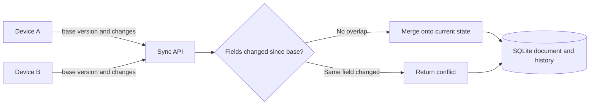
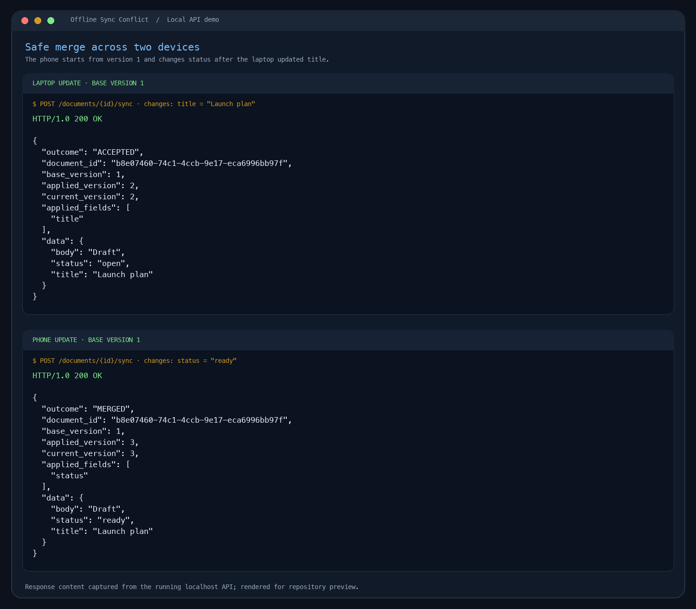
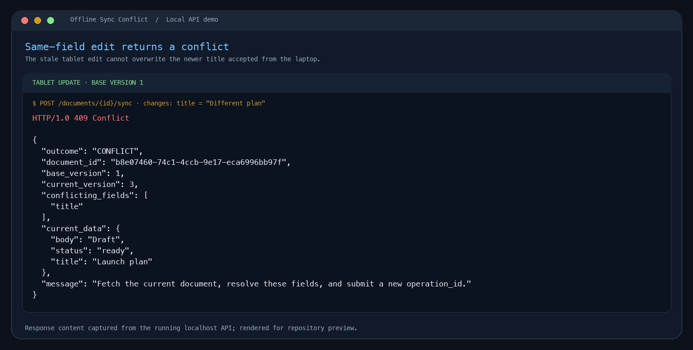
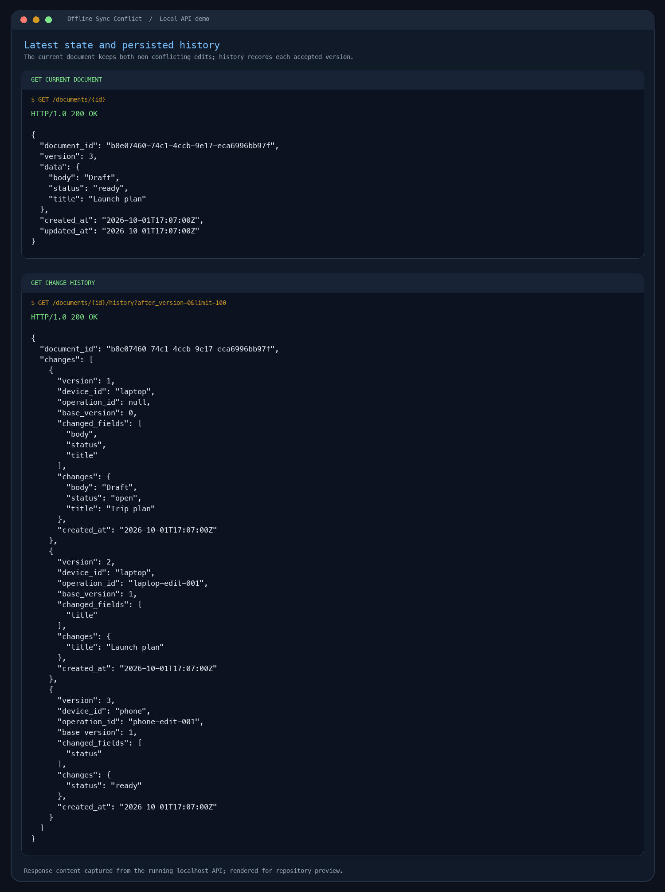

# Offline Sync Conflict

A small Python API that keeps changes from multiple devices from silently overwriting each other. It stores each document's current JSON state and a versioned change history in SQLite.

This project is built around one clear rule: two edits to different top-level fields can merge automatically; two edits to the same top-level field need a resolution from the client.

## What it demonstrates

- Multiple clients can read and update a shared document using a device ID.
- Every accepted edit advances the document version.
- Stale edits to independent fields are merged onto the latest document.
- Stale edits to a field that changed since the client's base version return a conflict and leave the document untouched.
- Repeated sync requests are idempotent when they reuse the same `operation_id` and request body.
- SQLite transactions make conflict detection, state updates, change history, and idempotency records atomic.
- A bounded history endpoint lets clients inspect changes after a particular version.

## Requirements

- Python 3.7 or newer
- No third-party Python packages

## Run locally

From this directory:

```bash
python3 run.py
```

The API listens at `http://127.0.0.1:8000` and creates `sync.sqlite3` in the current directory. Use `Ctrl+C` to stop it.

Optional settings:

```bash
python3 run.py --host 127.0.0.1 --port 8000 --db ./data/sync.sqlite3
```

The default bind address is local-only. The demo has no user authentication, so keep it on your machine and use sample data.

## Run the complete demo

Open a second terminal while the server is running. From the project directory, run:

```bash
bash examples/demo.sh
```

The script needs only `curl` and Python 3. It creates a fresh document each time and prints real HTTP responses for creation, an accepted update, a safe merge, a conflict, the latest document, and its history. You can also follow the individual `curl` requests below.

## How it works

Each document has one integer `version`. A device reads a snapshot, then submits the version it started from (`base_version`) along with the fields it changed.



For each stale request, the API reads the change log after `base_version`:

1. If none of the submitted fields appear in that history, the update is safe to merge. The API applies the changes to the latest state and returns `MERGED`.
2. If any submitted field also changed after the base version, the API returns `CONFLICT`, the conflicting field names, and the current snapshot. It does not alter the document.
3. If the base version is newer than the server's current version, the API rejects the request as `REJECTED`.

Changes are patches of top-level fields. A nested JSON object is treated as one field: edits anywhere inside that object may conflict. This conservative rule avoids silently combining nested edits the server cannot safely distinguish. After resolving a conflict, the client fetches the current document and sends a new request with a new `operation_id` and the current `base_version`.

### Atomicity and duplicate requests

The server opens a SQLite `BEGIN IMMEDIATE` transaction before it checks a document version. Conflict detection, the compare-and-swap update, history insertion, and idempotency record are committed together. This serializes competing writers and prevents a request from checking one version and overwriting another.

Each sync request also has a client-generated `operation_id`, unique per document. If the same ID and same request are received again, the API returns the original result with `replayed: true` instead of applying the edit twice. Reusing an ID with a different request body returns `409 idempotency_key_reused`. A replay returns the original response snapshot; call `GET /documents/{id}` to fetch the latest state.

## API

All request and response bodies use JSON.

| Method | Endpoint | Purpose |
| --- | --- | --- |
| `GET` | `/healthz` | Check that the server is responding. |
| `POST` | `/documents` | Create a document at version 1. |
| `GET` | `/documents/{document_id}` | Fetch the latest snapshot and version. |
| `POST` | `/documents/{document_id}/sync` | Submit a versioned change. |
| `GET` | `/documents/{document_id}/history?after_version=1&limit=100` | Read change events after a version. |

### Create a document

```bash
curl -i -X POST http://127.0.0.1:8000/documents \
  -H 'Content-Type: application/json' \
  -d '{"device_id":"laptop","data":{"title":"Trip plan","body":"Draft","status":"open"}}'
```

Copy the returned `document_id` into a shell variable for the following examples:

```bash
DOC_ID="paste-the-returned-document-id-here"
```

The new document starts at version `1`.

### Two devices make independent edits

Both devices start from version `1`. The laptop changes `title`:

```bash
curl -i -X POST "http://127.0.0.1:8000/documents/$DOC_ID/sync" \
  -H 'Content-Type: application/json' \
  -d '{"device_id":"laptop","operation_id":"laptop-edit-001","base_version":1,"changes":{"title":"Launch plan"}}'
```

The response is `ACCEPTED` at version `2`. The phone changes a different field from its older version `1` snapshot:

```bash
curl -i -X POST "http://127.0.0.1:8000/documents/$DOC_ID/sync" \
  -H 'Content-Type: application/json' \
  -d '{"device_id":"phone","operation_id":"phone-edit-001","base_version":1,"changes":{"status":"ready"}}'
```

The response is `MERGED` at version `3`; both `title: "Launch plan"` and `status: "ready"` remain in the document.

### Two devices edit the same field

The following stale edit also starts at version `1` and changes `title`:

```bash
curl -i -X POST "http://127.0.0.1:8000/documents/$DOC_ID/sync" \
  -H 'Content-Type: application/json' \
  -d '{"device_id":"tablet","operation_id":"tablet-edit-001","base_version":1,"changes":{"title":"Different plan"}}'
```

The response is HTTP `409` with `outcome: "CONFLICT"`, `conflicting_fields: ["title"]`, and the current snapshot. The stored document remains unchanged.

### Fetch the latest snapshot and history

```bash
curl -i "http://127.0.0.1:8000/documents/$DOC_ID"
curl -i "http://127.0.0.1:8000/documents/$DOC_ID/history?after_version=1&limit=100"
```

## Outcomes and errors

| HTTP status | Outcome or error | Meaning |
| --- | --- | --- |
| `200` | `ACCEPTED` | The device submitted a change based on the current version. |
| `200` | `MERGED` | The device was stale, but its changed fields did not overlap with later changes. |
| `409` | `CONFLICT` | At least one submitted field changed after the device's base version. No update was applied. |
| `409` | `REJECTED` | The device's `base_version` is ahead of the server. |
| `409` | `idempotency_key_reused` | An `operation_id` was reused with a different request. |
| `400` | `invalid_request` or `invalid_json` | The body, version, or fields are malformed. |
| `404` | `document_not_found` | The requested document does not exist. |
| `405` | `method_not_allowed` | The HTTP method is not supported by this API. |
| `413` | `request_too_large` | The body exceeds the 1 MB request limit. |
| `415` | `unsupported_media_type` | The request did not use `Content-Type: application/json`. |
| `503` | `database_busy` | SQLite could not acquire its write lock within five seconds; retry shortly. |

## Expected demo output

The generated document ID and timestamps will differ each run. The response bodies should have these values and shapes:

1. Document creation returns HTTP `201`, `version: 1`, and the input data.
2. The laptop request returns HTTP `200` with `outcome: "ACCEPTED"`, `applied_version: 2`, and `title: "Launch plan"`.
3. The phone request returns HTTP `200` with `outcome: "MERGED"`, `current_version: 3`, and both `title: "Launch plan"` and `status: "ready"` in `data`.
4. The tablet request returns HTTP `409` with `outcome: "CONFLICT"`, `conflicting_fields: ["title"]`, and the unchanged version 3 snapshot.
5. The final `GET` returns version 3. The history response contains the version 1 creation event and the accepted version 2 and version 3 changes.

Representative response bodies (replace `<document-id>` with the ID printed by the create request):

**Safe merge — HTTP 200**

```json
{
  "outcome": "MERGED",
  "document_id": "<document-id>",
  "base_version": 1,
  "applied_version": 3,
  "current_version": 3,
  "applied_fields": ["status"],
  "data": {
    "body": "Draft",
    "status": "ready",
    "title": "Launch plan"
  }
}
```

**Same-field conflict — HTTP 409**

```json
{
  "outcome": "CONFLICT",
  "document_id": "<document-id>",
  "base_version": 1,
  "current_version": 3,
  "conflicting_fields": ["title"],
  "current_data": {
    "body": "Draft",
    "status": "ready",
    "title": "Launch plan"
  },
  "message": "Fetch the current document, resolve these fields, and submit a new operation_id."
}
```

If a request instead returns `500` or `503`, save the full terminal output and check that only one server is using the selected database file.

## Design choices and scope

- The server is the source of truth; each request names the version from which the client edited.
- Field-level detection is performed at the top level of the JSON document. It safely merges independent fields and asks for resolution on overlapping edits.
- The server does not choose a last-write-wins policy. It returns the current state so a client or user can make the resolution decision.
- SQLite is file-backed so data and versions survive process restarts.
- Device IDs are labels supplied by clients, not authenticated identities. This is a local demonstration API, not a production multi-user service.
- Change history and idempotency records are retained for the lifetime of each document. The example does not implement history pruning or document deletion.

## Project layout

```text
offline_sync/
  engine.py       Version checks, conflict detection, merges, idempotency
  http_api.py     JSON routes, request validation, HTTP responses
  storage.py      SQLite schema and transaction handling
run.py            Local server entry point
```

## Submission screenshots

The recruitment brief asks for application screenshots in the GitHub repository. The `screenshots/` folder contains three API demo captures made from real responses returned by the local run. If you make changes, re-run `bash examples/demo.sh` and refresh the captures so they match your version.







To reproduce the screenshots yourself, start the API with `python3 run.py`, run the demo script in a second terminal, and capture the merge, conflict, and final-state responses. Put the images in `screenshots/` before uploading the repository.
